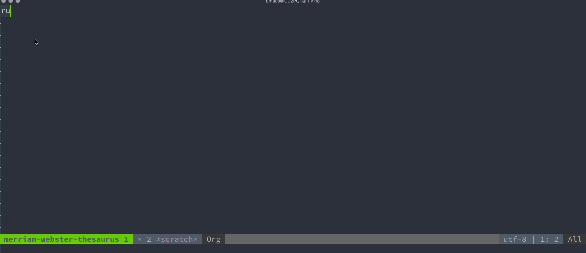

* Merriam-Webster Thesaurus
[[https://github.com/agzam/mw-thesaurus.el/actions/workflows/run-tests.yml][https://github.com/agzam/mw-thesaurus.el/actions/workflows/run-tests.yml/badge.svg]]

For more than 150 years, in print and now online, Merriam-Webster has been America's leading and most-trusted provider of language information.

This package allows you to lookup a word and displays its thesaurus definition in a pleasing outline (Org-mode) format

* Configure
** Entirely optional, and you don't have to do it at all
Again, *this is not required for the package to work!* You may want to do it anyway.

In order to use the Merriam-Webster API, it is necessary to register and obtain a free API key.

A free key allows like 1000 lookups a day, and every user of this package shares the default one.

Whether Merriam-Webster enforces the limit is unknown, because the API sends no rate-limit headers.

By default, this package uses one registered key; for whatever reason, if you prefer your own or the default fails, then set a new key.

People have been actively using the package for many years, and the key still works just fine, yet I could imagine some kind of spam detection upstream block-listing the key. Well, if that happens, just get a free account and set a key.

- [[https://www.dictionaryapi.com/register/index.htm][Register free account]] at Merriam-Webster's Developer Center
- Obtain a key
- Set the var
  #+begin_src emacs-lisp
  (setq mw-thesaurus-api-key "YOUR-API-KEY")
  #+end_src

It is on [[https://melpa.org/#/mw-thesaurus][MELPA]].

*** use-package example
#+begin_src emacs-lisp
(use-package mw-thesaurus
  :defer t
  :commands mw-thesaurus-lookup-dwim
  :hook (mw-thesaurus-mode . variable-pitch-mode)
  :config
  ;; window on the right side
  (add-to-list
   'display-buffer-alist
   `(,mw-thesaurus-buffer-name
     (display-buffer-reuse-window
      display-buffer-in-direction)
     (direction . right)
     (window . root)
     (window-width . 0.3))))
#+end_src

* Commands
~mw-thesaurus-lookup-dwim~ - bind that to any desired hotkey, and it would automatically search for a thesaurus definition using the region (if you have any text selected) or a word at the point, or if there's nothing - it prompts you for a word.

If the word has no entry, e.g. because of a typo, the first spelling suggestion from Merriam-Webster shows instead, but only when it differs by one or two letters, and in no more than half of the word: "hapy" shows "happy", while "etymology" shows nothing rather than "homology", and "I" nothing rather than "GI".
* Keys available in mw-thesaurus-mode
~RET~ lookup for the word at the cursor (lets you "drill" into definition further)

~q~ kill mw-thesaurus buffer and close the window
